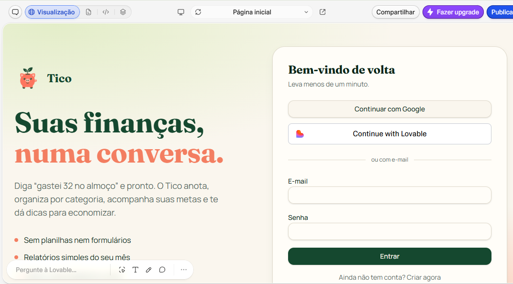
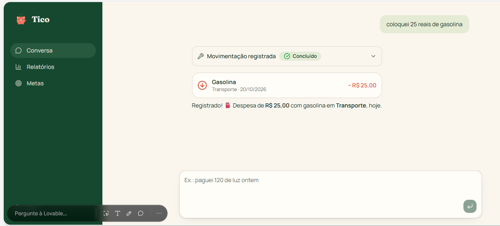
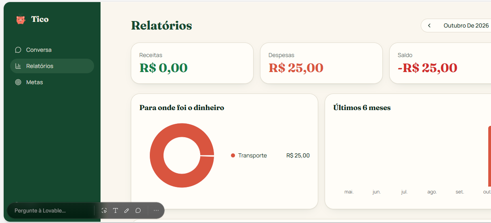

# 🐷 Tico — Assistente Financeiro Pessoal com IA

> **Suas finanças, numa conversa.**

Projeto desenvolvido como parte do desafio de Vibe Coding da [Digital Innovation One (DIO)](https://www.dio.me/), com o objetivo de transformar uma ideia em um conceito de aplicativo utilizando inteligência artificial e desenvolvimento orientado por prompts.

## 📌 Sobre o projeto

O **Tico** é um conceito de aplicativo de organização de finanças pessoais que permite registrar e consultar movimentações financeiras por meio de conversas em linguagem natural.

A proposta é tornar o controle financeiro mais simples e acessível, especialmente para pessoas que têm dificuldade em manter planilhas ou utilizar aplicativos que exigem muitos lançamentos manuais.

Por meio de uma experiência conversacional, o usuário pode registrar despesas, acompanhar suas movimentações e visualizar informações financeiras em relatórios simples.

## 🎯 Objetivos

- Facilitar o registro de receitas e despesas por meio de conversas.
- Automatizar a classificação das movimentações financeiras.
- Permitir o acompanhamento de metas de economia.
- Apresentar relatórios claros e acessíveis.
- Explorar o uso da inteligência artificial para simplificar tarefas do cotidiano.

## ✨ Funcionalidades desenvolvidas e propostas

- **Interface de acesso:** telas de login e cadastro.
- **Conversa financeira:** registro de despesas utilizando linguagem natural.
- **Confirmação de movimentações:** apresentação do valor, descrição, categoria e data do lançamento.
- **Relatórios financeiros:** visualização de receitas, despesas, saldo e distribuição de gastos por categoria.
- **Metas financeiras:** área destinada ao acompanhamento de objetivos de economia.

As funcionalidades acima representam o escopo visual e funcional observado durante a exploração do projeto. A implementação de cada recurso deve ser considerada conforme seu estágio real de desenvolvimento e validação.

## 🖥️ Demonstração visual

### 1. Tela inicial e acesso

A tela inicial apresenta a identidade visual do Tico e comunica sua principal proposta: organizar as finanças por meio de conversas, sem planilhas ou formulários complexos.

### 2. Registro de despesas por conversa

O usuário informa uma despesa em linguagem natural. No exemplo testado, a mensagem informa um gasto de R$ 25,00 com gasolina, e a interface apresenta a movimentação classificada na categoria Transporte.

### 3. Relatórios financeiros

O painel apresenta um resumo das receitas, despesas e saldo, além de gráficos para facilitar a compreensão da distribuição dos gastos e da evolução financeira.

## 🧪 Testes realizados

Durante a exploração do protótipo, foi realizado um teste de persistência das movimentações financeiras.

**Cenário testado:**
1. Registrar uma despesa de R$ 25,00 com gasolina.
2. Verificar a confirmação da movimentação na interface.
3. Atualizar a página.
4. Verificar se a despesa continuava registrada.

**Resultado:** a despesa permaneceu salva após a atualização da página.

Esse teste demonstrou que a movimentação registrada continuou disponível após recarregar a interface. Outros cenários, como autenticação, edição, exclusão e integridade dos dados, ainda precisam ser validados individualmente.

## 📝 PRD — Prompt final utilizado

### Contexto

Quero criar um aplicativo de organização de finanças pessoais que funcione por meio de conversas com o usuário.

A ideia é facilitar o controle financeiro de forma simples e natural, permitindo registrar e consultar receitas e despesas por mensagens, sem depender de formulários manuais ou planilhas complexas.

### Problema

Muitas pessoas têm dificuldade para manter suas finanças organizadas porque os aplicativos tradicionais exigem muitos lançamentos manuais e nem sempre oferecem uma experiência simples e personalizada.

Quero resolver esse problema por meio de uma experiência conversacional que facilite o registro das movimentações financeiras e ofereça informações úteis para ajudar o usuário a compreender seus hábitos de consumo e identificar oportunidades de economia.

### Público-alvo

Pessoas que desejam começar a organizar suas finanças de forma prática e sem complicação, principalmente iniciantes que têm dificuldade para controlar gastos e acompanhar o próprio orçamento.

### Funcionalidades-chave

1. **Registro de movimentações via chat:** permitir que o usuário registre receitas e despesas utilizando linguagem natural.
2. **Classificação automática:** identificar e categorizar as movimentações com base nas informações fornecidas.
3. **Consulta e correção via chat:** permitir consultar, editar e excluir movimentações por meio de conversas.
4. **Metas financeiras:** permitir definir objetivos de economia e acompanhar seu progresso.
5. **Agente Financeiro:** oferecer dicas e sugestões personalizadas para ajudar o usuário a economizar e organizar suas finanças.
6. **Relatórios simples:** apresentar receitas, despesas, saldo e informações financeiras em visualizações fáceis de compreender.

### Entregável da IA

Gerar um plano inicial para desenvolver um MVP, contendo as principais telas, funcionalidades essenciais, recursos técnicos necessários e uma proposta de validação com usuários.

O plano deverá priorizar a simplicidade, a facilidade de uso e a implementação incremental, evitando funcionalidades desnecessárias na primeira versão.

Utilizar tom educativo e linguagem acessível, em português brasileiro.

## 🤖 Ferramenta utilizada

- [Lovable](https://lovable.dev/) — utilizado para gerar a interface do aplicativo a partir do PRD e orientar a criação do protótipo por meio de prompts.

## 💡 Aprendizados e reflexão

A experiência com Vibe Coding mostrou como uma ideia pode ser transformada em uma interface visual a partir de instruções escritas em linguagem natural.

Aprendi a importância de estruturar um PRD antes de solicitar a geração do aplicativo, definindo o problema, o público-alvo e as funcionalidades desejadas.

Também percebi que a inteligência artificial acelera o processo de criação, mas não elimina a necessidade de testar o resultado. A validação da persistência das despesas foi um exemplo prático dessa importância.

O projeto reforçou meu interesse em utilizar ferramentas de inteligência artificial como apoio ao desenvolvimento de software, combinando clareza na definição dos requisitos, experimentação e validação incremental.

## 🚀 Próximos passos

- Validar as funcionalidades de cadastro e autenticação.
- Testar a classificação de diferentes tipos de receitas e despesas.
- Implementar e validar as metas financeiras.
- Verificar a consistência dos relatórios e cálculos.
- Melhorar a experiência em dispositivos móveis.
- Avaliar o aplicativo com usuários reais.

## 👨‍💻 Autor

**Rafael Silva Pereira**

Projeto desenvolvido para fins educacionais como parte do desafio de Vibe Coding da DIO.

---

*Este projeto representa a aplicação prática de engenharia de prompts, prototipação assistida por IA e validação incremental de uma ideia de produto.*
