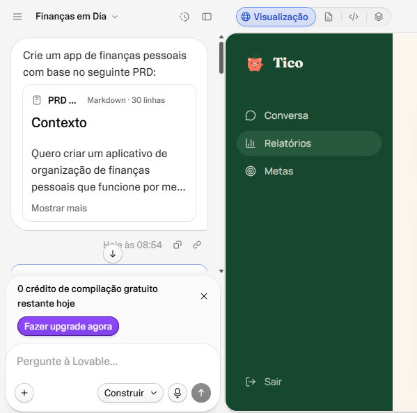
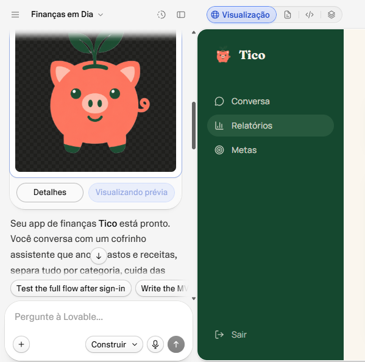

# 🐷 Tico — Assistente Financeiro Pessoal com IA

> **Suas finanças, numa conversa.**

Projeto desenvolvido para o desafio de Vibe Coding da [Digital Innovation One (DIO)](https://www.dio.me/), utilizando o Lovable para transformar um PRD em um conceito visual de aplicativo de organização financeira pessoal.

## 📌 Sobre o projeto

O **Tico** é um conceito de aplicativo que busca simplificar a organização das finanças pessoais por meio de conversas em linguagem natural. A proposta é permitir que o usuário registre despesas e consulte informações financeiras sem depender de planilhas ou de formulários complexos.

A interface criada apresenta uma experiência conversacional, confirmação de movimentações e um painel com relatórios financeiros.

## 🎯 Objetivos

- Facilitar o registro de receitas e despesas por meio de conversas.
- Classificar movimentações financeiras automaticamente.
- Permitir o acompanhamento de metas de economia.
- Apresentar relatórios simples e fáceis de compreender.
- Explorar o uso de IA como apoio à criação de um produto digital.

## ✨ Funcionalidades representadas no protótipo

- **Tela de acesso:** interface de login e cadastro.
- **Conversa financeira:** registro de despesas em linguagem natural.
- **Confirmação de movimentação:** apresentação de descrição, valor, categoria e data.
- **Relatórios:** resumo de receitas, despesas e saldo, além de gráficos por categoria e por período.
- **Metas financeiras:** seção prevista para acompanhar objetivos de economia.

> O protótipo apresenta a proposta visual do produto. Cada funcionalidade deve ser considerada implementada apenas na medida em que foi efetivamente testada.

## 🖥️ Demonstração visual

### 1. Tela inicial e acesso

A tela inicial apresenta a identidade visual do Tico e sua proposta: organizar as finanças por meio de conversas.

### 2. Registro de despesa por conversa

Exemplo de registro de uma despesa de R$ 25,00 com gasolina, categorizada como Transporte.

### 3. Relatórios financeiros

Painel com receitas, despesas, saldo e visualizações dos gastos.

## 🧠 Processo de Vibe Coding

O projeto começou com a definição de um PRD (Product Requirements Document), descrevendo o contexto, o problema, o público-alvo, as funcionalidades-chave e o resultado esperado. Em seguida, o PRD foi utilizado como orientação para gerar uma interface visual no Lovable.

### PRD utilizado

**Prompt final (PRD):**

#### Contexto
Quero criar um aplicativo de organização de finanças pessoais que funcione por meio de conversas com o usuário.

A ideia é facilitar o controle financeiro de forma simples e natural, permitindo registrar e consultar receitas e despesas por mensagens, sem depender de formulários manuais ou planilhas complexas.

#### Problema
Muitas pessoas têm dificuldade para manter suas finanças organizadas porque os aplicativos tradicionais exigem muitos lançamentos manuais e nem sempre oferecem uma experiência simples e personalizada.

Quero resolver esse problema por meio de uma experiência conversacional que facilite o registro das movimentações financeiras e ofereça informações úteis para ajudar o usuário a compreender seus hábitos de consumo e identificar oportunidades de economia.

#### Público-alvo
Pessoas que desejam começar a organizar suas finanças de forma prática e sem complicação, principalmente iniciantes que têm dificuldade para controlar gastos e acompanhar o próprio orçamento.

#### Funcionalidades-chave
1. **Registro de movimentações via chat:** permitir que o usuário registre receitas e despesas utilizando linguagem natural.
2. **Classificação automática:** identificar e categorizar as movimentações com base nas informações fornecidas.
3. **Consulta e correção via chat:** permitir consultar, editar e excluir movimentações por meio de conversas.
4. **Metas financeiras:** permitir definir objetivos de economia e acompanhar seu progresso.
5. **Agente Financeiro:** oferecer dicas e sugestões personalizadas para ajudar o usuário a economizar e organizar suas finanças.
6. **Relatórios simples:** apresentar receitas, despesas, saldo e informações financeiras em visualizações fáceis de compreender.

#### Entregável da IA
Gerar um plano inicial para desenvolver um MVP, contendo as principais telas, funcionalidades essenciais, recursos técnicos necessários e uma proposta de validação com usuários.

O plano deverá priorizar a simplicidade, a facilidade de uso e a implementação incremental, evitando funcionalidades desnecessárias na primeira versão.

Utilizar tom educativo e linguagem acessível, em português brasileiro.

### Resultado final no Lovable

As capturas acima documentam o briefing utilizado e o resultado visual obtido. Substitua os arquivos de evidência pelos screenshots reais correspondentes para que todas as imagens apareçam no GitHub.

## 🧪 Teste realizado

Foi realizado um teste de persistência de uma movimentação financeira:

1. Registrar uma despesa de R$ 25,00 com gasolina.
2. Conferir a confirmação da movimentação na interface.
3. Atualizar a página.
4. Verificar se a despesa continuava registrada.

**Resultado observado:** a despesa permaneceu salva após a atualização da página.

Esse teste confirma o comportamento observado nesse cenário específico. Outros cenários, como autenticação, edição, exclusão, integridade dos dados e cálculos em diferentes períodos, precisam ser validados separadamente.

## 🛠️ Ferramenta utilizada

- [Lovable](https://lovable.dev/) — utilizado para gerar a interface visual a partir do PRD e explorar o desenvolvimento orientado por prompts.

## 💡 Aprendizados e reflexão

A experiência com Vibe Coding mostrou como uma ideia pode ser transformada em uma interface visual a partir de instruções escritas em linguagem natural.

O processo reforçou a importância de estruturar um PRD antes de solicitar a geração do aplicativo, definindo o problema, o público-alvo e as funcionalidades desejadas.

Também ficou evidente que a IA acelera a criação, mas não elimina a necessidade de testar o resultado. A verificação da persistência de uma despesa foi um exemplo prático da importância de validar o comportamento observado, em vez de presumir que tudo funciona apenas porque a interface foi gerada.

O projeto ampliou minha compreensão sobre o uso de prompts claros, a experimentação incremental e a validação de resultados durante o desenvolvimento assistido por IA.

## 🚀 Próximos passos

- Capturar e incluir as evidências reais do PRD e da interação com o Lovable.
- Validar cadastro e autenticação.
- Testar a classificação de diferentes receitas e despesas.
- Verificar os cálculos e filtros dos relatórios.
- Testar a criação e o acompanhamento de metas.
- Avaliar a experiência em dispositivos móveis.

## 👨‍💻 Autor

**Rafael Silva Pereira**

Projeto desenvolvido para fins educacionais como parte do desafio de Vibe Coding da DIO.

---

[Repositório do projeto](https://github.com/rafaelsilvapereira/dio-lab-vibe-coding-app-financas)
